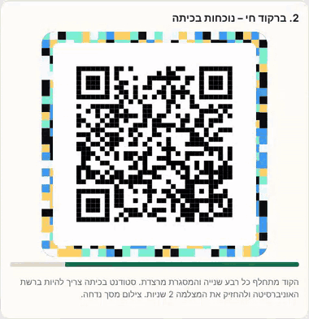

# ZooMoodle

A KISS teaching tool for one lesson: the lecturer opens a lesson room, students join from their phones, and the lecturer gets a trustworthy attendance sheet plus live feedback — notes, questions, polls, an AI lesson summary and an AI homework review.

Individual project, Introduction to Software Engineering (OOP/OOD), Exercise 2 — *Vibe Coding & Deep Designing*. Deadline: 25 November 2026. Demo course: **מערכות נוירונים, week 4, lecturer טום יניב**.

## 1. The problem

The online tools used in class today "are not doing it":

- **Attendance is easy to fake and slow to check.** A sign-up sheet or a Moodle button can be filled in by a friend, or from home with a photo of the screen. Counting heads by hand wastes lesson time and still gives no sheet.
- **The lecturer does not know what the class understood** until the exam. Students rarely ask out loud; there is no quick way to run a poll or collect anonymous notes.
- **Recordings and homework are not used.** The Zoom auto-summary is generic, and nobody has time to give every student personal feedback on homework or to compare submissions.

**Goal:** a simple, phone-based, LLM-ready web app that works in *this* classroom and can be demoed in 10 minutes.

## 2. Scope — the five requested features

| # | Feature (from the assignment) | Our solution | Where |
| --- | --- | --- | --- |
| 1 | **Attendance** (main feature) + online/offline spreadsheet | Student picks a name on the phone. *In class* is verified by two factors: **campus Wi-Fi + live barcode** (see §3). *Remote* is one tap. The lecturer sees a live list (online) and downloads CSV/Excel (offline). | `checkin.py`, `screen_qr.py`, `net.py`, `export_svc.py` |
| 2 | Student comments and suggestions | Notes and questions from the phone; classmates up-vote questions; the dashboard sorts by votes. | `store.py` |
| 3 | On-the-spot (KISS) polls | Question + 2–6 answers, optional correct answer, live counts. | `store.py` |
| 4 | ML summary of the class video | The lecturer uploads the **transcript** Zoom/Meet already export (VTT/TXT); an LLM agent links topics to poll mistakes and student questions and publishes the summary to the class. | `llm/agent.py` |
| 5 | Deep LLM homework review with comparison to other students | Students submit an answer from the phone; the LLM agent reviews it and compares it **anonymously** with the other submissions (Jaccard similarity tool). Review, not a grade. | `llm/agent.py`, `llm/tools.py` |

Out of scope (assignment guideline 1): Moodle/Zoom integration, university login and personal-data systems, native apps, a database.

## 3. Our attendance solution: two-factor check-in

The assignment suggests a photo + automatic head count. We chose a different way that also tells **who** is in class, not only **how many**: an in-class check-in needs **two independent factors** — something only a person *on campus* has, and something only a person *in the room* can see.

<p align="center"></p>

| Factor | What the student must have | How it is checked | What it stops |
| --- | --- | --- | --- |
| **1. University network** | The phone is on the campus Wi-Fi | The **server** reads the phone's real public IP and requires it to be in the university ranges (`192.114.48.0/21`, `192.114.56.0/23`). Nothing the phone sends can change it. | Checking in from home or over cellular data |
| **2. Live barcode** (the GIF above) | The phone's camera sees the lecturer's screen *now* | The screen shows a signed QR that **changes every 250 ms** inside a 20 Hz shimmering border. The phone must hold on it for **2 s** and collect **≥5 different codes**, each ≤6 s old, from this room, never used before. | A photo or screenshot sent by a friend (holds one code only), a recording replayed later, a code from another lesson |

Each factor alone is weak: a dorm is on the campus network, and a friend can send a photo. **Together** a student must be on campus *and* see the live screen — in practice, in the room.

**Student flow (one screen per step):** scan the join QR → pick your name → **בכיתה** (both checks, then choose your area in the room) or **מרחוק** (no checks) → *✓ ברוך הבא ‹name›*. No ID number and no e-mail are ever asked.

**Duplicate names** are resolved automatically, in stages:

| Stage | Situation | What happens |
| --- | --- | --- |
| 1 | The same name is used remotely and verified in class | In class wins; the remote entry is flagged for the lecturer. |
| 2 | Two verified in-class phones choose one name | Both get a popup and re-pick their real name. |
| 3 | They pick the same name again | A **one-time code** (6 digits) is e-mailed to that student's address from the class list (e.g. their Gmail). Whoever types it gets the name; the other phone is rejected. No lecturer needed. |
| 4 | Nobody types the right code (5 min, 3 tries per phone) | Every claim on that name is rejected; the students start again from the name list. |

The lecturer can still accept or reject any claim by hand.

**Privacy.** The roster's ID column is ignored and never stored. E-mails are stored as salted HMACs; the plain address stays only in server memory to send the one-time code, and is never shown, returned or exported. The code itself is stored only as an HMAC. The lecturer key is never printed or committed, and each phone signs its requests with its own session key. LLM API keys are used for one request and dropped; the model only sees pseudonyms (`P-1a2b3c4d`).

## 4. Run it

```bash
cd demo-web
python3 -m venv .venv && source .venv/bin/activate
pip install -r requirements.txt
cp .env.example .env          # optional settings, never committed
python -m app.main            # http://127.0.0.1:8000/
```

- The lecturer key is created at `~/.zoomoodle/lecturer-key.txt` (mode 600) on first start; only the path is printed.
- Phones need **HTTPS** for the camera: deploy on Render (`demo-web/render.yaml`) or run `cloudflared tunnel --url http://127.0.0.1:8000`, and open the lecturer page through that URL.
- **One-time codes by Gmail:** in `.env` (or the Render dashboard) set `ZOOMODLE_SMTP_HOST=smtp.gmail.com`, `ZOOMODLE_SMTP_USER` / `ZOOMODLE_SMTP_FROM` = the sending Gmail address, and `ZOOMODLE_SMTP_PASSWORD` = a Gmail **App Password** (Google Account → Security → 2-Step Verification → App passwords). `DEMO_EMAIL_OVERRIDE` sends every code to one inbox for the demo. Without SMTP the code is shown on the lecturer dashboard as "מצב הדגמה – המייל לא נשלח".
- To try the in-class path at home, add your own address to `ZOOMODLE_CAMPUS_RANGES` in `.env` (local browser: `127.0.0.1/32`).
- Tests: `python -m pytest -q` from `demo-web/` (71 tests).
- State is in memory: export the sheet before stopping the server. Proxy/IP details: [components](docs/06-components.md#client-ip-behind-a-proxy).

## 5. Assignment deliverables

| To-do | Item | File |
| --- | --- | --- |
| 1 | Problem and scope | this README |
| 3 | Tools report (incl. vibe-coded vs. composed) | [docs/02-tools-report.md](docs/02-tools-report.md) |
| 4 | Statement of work | [docs/03-SoW.md](docs/03-SoW.md) |
| 5 | SRS and threat model | [docs/04-SRS.md](docs/04-SRS.md) |
| 6 | Use cases (client stories) | [docs/05-use-cases.md](docs/05-use-cases.md) |
| 7 | Software components | [docs/06-components.md](docs/06-components.md) |
| 8 | Class, state and sequence diagrams, OOD | [docs/07-design.md](docs/07-design.md) |
| 9 | Testing strategy (mapped to classes) | [docs/08-testing-strategy.md](docs/08-testing-strategy.md) |
| 10 | Demo web app | [`demo-web/`](demo-web/) |
| 11 | 10-minute demo script | [docs/10-demo-script.md](docs/10-demo-script.md) |
| 12 | Conclusions | [docs/11-conclusions.md](docs/11-conclusions.md) |

**Still to verify in class:** a real phone camera on the projected barcode, the campus Wi-Fi as seen from Render, real Gmail delivery of the one-time code, and a live LLM call. Results go in the [tools report](docs/02-tools-report.md#5-real-life-checks).
