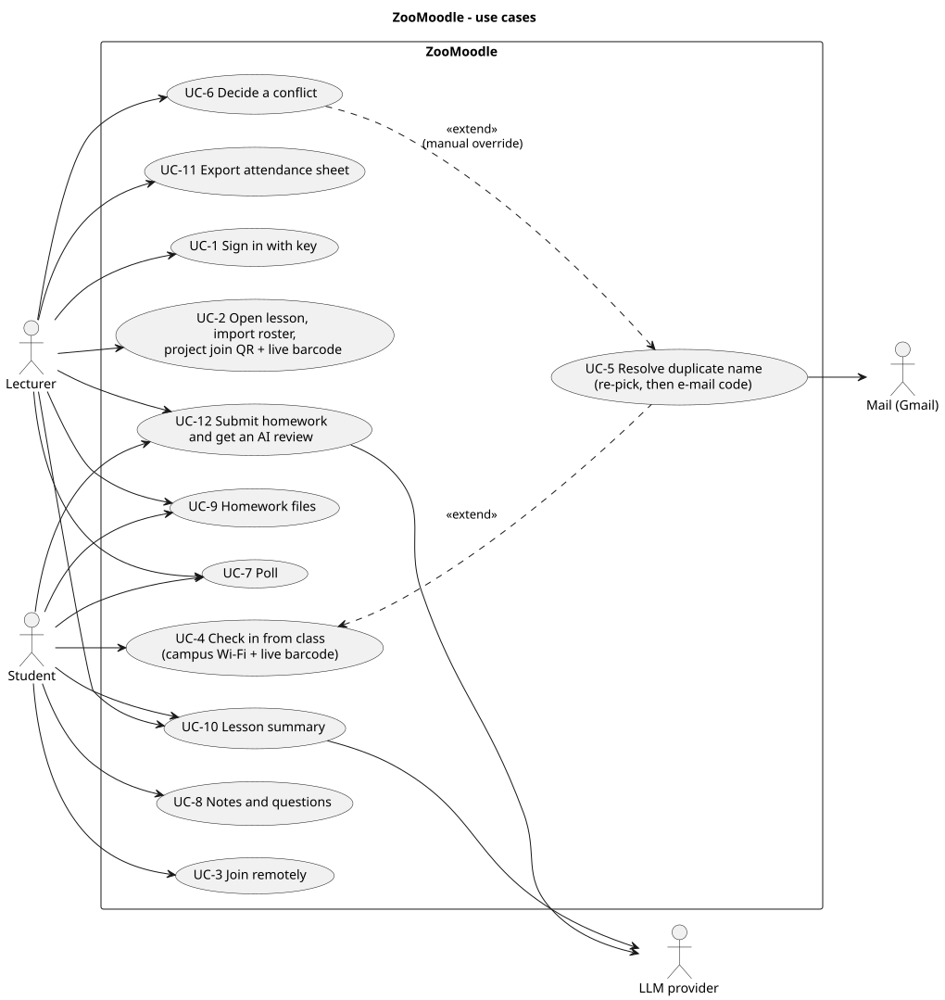

# Use cases (client stories)

Actors: **Lecturer**, **Student**, **LLM provider** (external, optional).

Source: `docs/diagrams/usecases.puml`. Each use case starts with the client story, then the acceptance criteria. The three central ones (UC-2, UC-4, UC-12) also have a full flow.

## UC-1 Lecturer signs in
**Story:** As a lecturer, I want to sign in with one private key, so that only I can open lessons and see the class.
**Accept:** right key → "שלום טום יניב, השבוע שבוע 4 בקורס מערכות נוירונים"; wrong key → 401, 10 failures in 5 min → 429; the key is never echoed; lecturer routes need the session token. (FR-1)

## UC-2 Lecturer opens a lesson
**Story:** As a lecturer, I want to open a lesson and put a join QR and a live barcode on the projector, so that students can check in without me calling names.

| | |
| --- | --- |
| Precondition | Signed in (UC-1); a roster CSV is at hand. |
| Main flow | 1. Lecturer presses "פתח שיעור חדש". 2. The system creates a room and shows its join QR. 3. Lecturer imports the roster CSV. 4. The system shows "נטענו N שמות", ignoring the ID column. 5. The system shows the live barcode, changing every 250 ms. |
| Alternatives | 3a. CSV without name or e-mail columns → "roster_headers" error, nothing imported. 3b. The roster has a group column → the list can be limited to one group (`POST /roster/group`; API only in the demo). |
| Postcondition | Students can open the student page; the dashboard is live. |

**Accept:** the roster shows names only; the barcode changes every 250 ms and shimmers. (FR-2–FR-4)

## UC-3 Student joins remotely
**Story:** As a student at home, I want to mark myself remote in one tap, so that the lecturer knows I follow the lesson online.
**Accept:** ✓ remote and "ברוך הבא ‹name›"; no network or barcode needed. (FR-6)

## UC-4 Student checks in from class
**Story:** As a student in class, I want to check in from my phone in a few seconds, so that I am marked present and nobody can mark me from home.

| | |
| --- | --- |
| Precondition | The lesson is open (UC-2); the phone is on the campus Wi-Fi. |
| Main flow | 1. Student scans the join QR. 2. Picks their name. 3. Chooses בכיתה. 4. The server checks the phone's IP is in the campus ranges. 5. Student holds the camera on the live barcode for 2 s. 6. The phone sends the codes it read. 7. The server re-checks the IP and verifies ≥5 fresh, ordered, unused codes of this room. 8. Student picks their area on the 3×3 map. 9. The system shows "✓ ברוך הבא ‹name›" and the dashboard counts them in class. |
| Alternatives | 4a. Not on the campus network → `not_on_campus_network`; the student may join remotely (UC-3). 7a. A screenshot/photo → `qr_static`. 7b. Too short → `qr_short`. 7c. Stale, reused or other-room codes → refused. 7d. The name is already verified by another phone → UC-5. |
| Postcondition | The claim is `present` with an area; it appears in the sheet. |

**Accept:** all alternatives above refuse the check-in; forged forwarding headers do not help. (FR-7, FR-8)

## UC-5 Duplicate name
**Story:** As a lecturer, I want two phones that claim one name to be sorted out with one short step, so that the right student gets it. As a student, I want the lecturer to confirm the name is mine, so that a classmate cannot take it.

| | |
| --- | --- |
| Precondition | Two phones verified in class (UC-4) with the same name. |
| Main flow | 1. The system shows both phones a re-pick popup. 2. Both pick the same name again. 3. Both phones show "המרצה יגיע אליך" with a code box; the lecturer dashboard shows a 6-digit one-time code. 4. The lecturer walks to the real student and types the code on that phone. 5. The system gives that phone the name ("ברוך הבא") and removes the other phone from it ("לא אושר" + "התחל מחדש"). |
| Alternatives | 2a. One phone picks another free name → both are resolved, no code. 4a. Wrong code → "הקוד שגוי", up to 3 tries per phone; 6 wrong tries in total → a new code on the dashboard. 4b. 2 minutes pass → a new code on the dashboard; the phones keep waiting. 4c. The lecturer presses accept or reject on the dashboard instead. 5a. The removed phone presses "התחל מחדש" and checks in again with its own name. |
| Postcondition | At most one phone holds the name; the other phone can check in again with another name. |

**Accept:** remote vs. verified in class → remote flagged; re-pick resolves; the code is never in a student response; the phone the code is typed on gets the name and the other is removed; a wrong code is refused; the code works once; the removed phone can re-enter with another name. (FR-9)

## UC-6 Lecturer overrides a conflict
**Story:** As a lecturer, I want to be able to give a disputed name to the right phone by hand, so that the sheet is correct even when the automatic flow is not enough (e.g. a flagged remote claim).
**Accept:** open conflicts appear on the dashboard; "זה הוא" gives the name and rejects the other claims; "דחה" shows "לא אושר" on that phone. (FR-9)

## UC-7 Poll
**Story:** As a lecturer, I want to ask a quick question and see the answers live, so that I know whether the class understood.
**Accept:** the dashboard shows live counts; each student answers once; students see counts after voting or when the poll is closed. (FR-11)

## UC-8 Notes and questions
**Story:** As a student, I want to send a note or a question during the lesson and up-vote others' questions, so that I am heard without interrupting.
**Accept:** the dashboard shows notes with names and questions sorted by votes; only checked-in students can post. (FR-12)

## UC-9 Homework files
**Story:** As a lecturer, I want to hand out a homework file from the dashboard, so that students download it from the same page.
**Accept:** lecturer-only upload, ≤5 MB; download requires a checked-in session and is served as an attachment. (FR-13)

## UC-10 Lesson summary
**Story:** As a lecturer, I want a summary of the recorded lesson that also uses the polls and questions, so that students get a useful recap and I see what to repeat.
**Accept:** after uploading the Zoom/Meet transcript, the summary is written by the agent (with a key) or by hand, and appears to all students of the room; only the lecturer can generate it; keys are never stored, logged or returned. (FR-14)

## UC-11 Export the attendance sheet
**Story:** As a lecturer, I want the attendance as a spreadsheet, so that I can keep it offline and upload it where I need.
**Accept:** CSV/XLSX with name, mode, state, area, time; no e-mail or ID. (FR-10)

## UC-12 Submit homework and get an AI review
**Story:** As a student, I want feedback on my homework and to know how it compares with the class, so that I can improve before the deadline. As a lecturer, I want a review of any submission, so that I can spot weak or copied work quickly.

| | |
| --- | --- |
| Precondition | The student is checked in (UC-3/UC-4); the caller has an LLM key. |
| Main flow | 1. Student pastes the answer or picks a text/code file and presses הגש. 2. The system stores it (a new one replaces the old). 3. Student (or lecturer) presses "בקש ביקורת" with provider, model and key. 4. The system builds an anonymous snapshot (pseudonyms, names redacted). 5. The agent reads the submission, calls `compare_submissions` on other submissions, and produces strengths, issues and a comparison. 6. The system shows the review, marked "זו ביקורת ולא ציון", and drops the key. |
| Alternatives | 1a. Empty or >100,000 characters → refused. 3a. A student asks about someone else's submission → 403. 3b. Only one submission in the room → "need_two_submissions_to_compare". 5a. The model fails or never produces a valid report → an error, no invented text. |
| Postcondition | Nothing is stored except the submission; the review is returned to the caller only. |

**Accept:** as above; the model never sees a real name. (FR-15)
