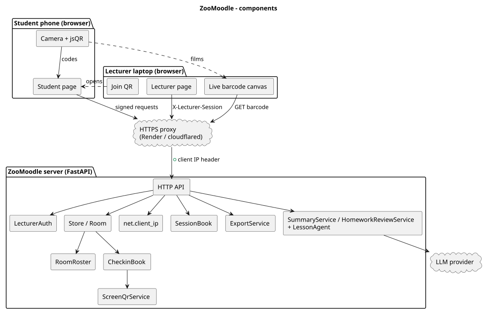
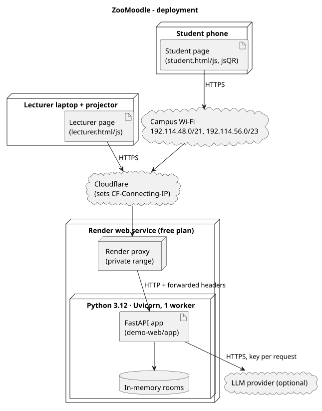

# Software components

One Python process, two static pages, no database. Arrows in the diagram are call direction.

Source: `docs/diagrams/components.puml`.

## Browser

| Component | Responsibility | Talks to |
| --- | --- | --- |
| Lecturer page (`lecturer.html/js`) | Key sign-in and greeting, open lesson, roster import, join QR, live barcode (QR + shimmer canvas), dashboard, conflict buttons, polls, homework files, submissions + AI review, summary, export. | `/api/...` with `X-Lecturer-Session`. |
| Student page (`student.html/js`) | Name list, בכיתה/מרחוק, camera scan, area map, re-pick popup, lecturer-code box, start over, note/question/poll, homework download, homework submission + AI review, summary. | `/api/...`; every call after join signed with the session key (HMAC, timestamp, nonce). |
| `qr.js` / `jsqr.js` | Draw QR codes / decode camera frames. | Local only. |

## Server (`demo-web/app/`)

| Component | Responsibility | Interface |
| --- | --- | --- |
| HTTP API (`main.py`) | Routes, lecturer/student auth, JSON errors, file responses, one place that builds an LLM provider and drops the key (`_run_llm`). | REST under `/api`. |
| `LecturerAuth` | HMAC of the lecturer key, rate limit, session tokens. | `sign_in`, `check`, `sign_out`. |
| `Settings` (`config.py`) | Env and key file, campus ranges, trusted proxies, greeting. | `from_env`. |
| `Store` / `Room` | In-memory rooms, polls, notes, questions, homework files, submissions, summary; anonymous agent snapshot. | Methods on `Store`. |
| `RoomRoster` | CSV import (names only), optional group filter. | `replace_from_csv`, `public_names`, `get`. |
| `CheckinBook` | Claims, network + barcode gate, area, duplicate stages, one-time lecturer codes, lecturer override. | `join`, `submit_barcode`, `choose_area`, `repick`, `submit_code`, `decide`. |
| `ScreenQrService` | Issue and verify signed 250 ms codes and the shimmer seed. | `issue`, `verify_sequence`. |
| `net.client_ip` | Real client IP behind trusted proxies; range match. | `client_ip`, `subnet_status`. |
| `SessionBook` | Per-phone session secrets and signed-request verification. | `issue`, `verify`. |
| `ExportService` | CSV/XLSX sheet. | `to_csv`, `to_xlsx`. |
| `SummaryService` / `HomeworkReviewService` | Run the agent for feature 4 / feature 5. | `summarize`, `review`. |
| `LessonAgent` + `ToolRegistry` | Tool-calling loop over read-only, anonymous data tools; validates the final report. | `run(task, snapshot)`. |
| `LLMClient` + providers | One interface over OpenAI-compatible, Anthropic and Gemini APIs. | `complete(messages, tools)`. |

## External

- **LLM provider** (optional) — called only when someone supplies a key.
- **Render / cloudflared** — HTTPS in front of the app; the proxy appends the client IP.

## Deployment

Source: `docs/diagrams/deployment.puml`. One free Render web service (`demo-web/render.yaml`): Python 3.12, one Uvicorn worker, health check `/api/health`, state in memory. Phones and the laptop reach it over HTTPS through Cloudflare and Render's proxy; the app calls an LLM provider only when a key is supplied.

## Client IP behind a proxy

The campus check (factor 1) depends on reading the phone's real public IP, which arrives through a proxy:

- Forwarded headers are trusted only when the socket peer is in `ZOOMODLE_TRUSTED_PROXIES` (loopback for cloudflared; on Render also the private ranges of Render's proxy, see `render.yaml`).
- From a trusted peer the server uses `CF-Connecting-IP` / `True-Client-IP`. Cloudflare sets and overwrites these headers, both for cloudflared and in front of Render.
- If they are missing, it takes the right-most `X-Forwarded-For` hop that is neither a trusted proxy nor a Cloudflare address. A browser-supplied left-most hop is ignored.
- On Render set `ZOOMODLE_MASTER_SECRET` and `ZOOMODLE_LECTURER_KEY` in the dashboard; `FORWARDED_ALLOW_IPS` stays `127.0.0.1`.
