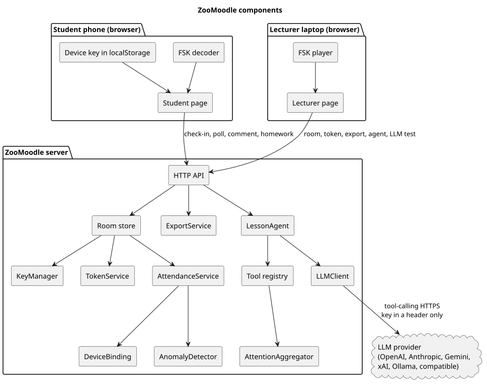

# Software components

The demo is one Python process and two static pages. Arrows in the diagram are call direction.

Source: `docs/diagrams/components.puml`.

## Browser

| Component | Responsibility | Interface |
| --- | --- | --- |
| Lecturer page | Unlock, open a room, play the beacon, sheet, export, polls, transcript, agent, attention samples, LLM form. | `fetch` to `/api/...` with `X-Lecturer-Token`. |
| FSK player | Turn the current 6-byte payload into a looping 18/19 kHz buffer. | `ZooFSK.encode` in `app/static/fsk.js`, Web Audio. |
| Student page | Identity, seat map, microphone or typed code, remote check-in, poll, comment, homework. | Public POST routes. Device key stays in `localStorage`. |
| FSK decoder | Search the microphone PCM for the preamble and return the payload bytes, then Base32. | `ZooFSK.decode`. Same framing as `app/audio_fsk.py`. |
| Device key | P-256 key pair created on first visit. Signs `challenge id \| nonce`. | WebCrypto. Server stores the public JWK only. |

The lecturer token lives in `sessionStorage` on that browser. The API key is not stored in the browser after the request; the password field is cleared.

## Server

| Component | Responsibility | Interface |
| --- | --- | --- |
| HTTP API (`app/main.py`) | Routes, lecturer-token check, client IP, error JSON. | REST under `/api`. |
| Room store | In-memory rooms, polls, comments, homework, transcript, names. Builds the agent snapshot with names removed. | Python methods on `Store`. |
| KeyManager | HKDF room key from the master secret and the room salt. | `derive_room_key(salt) -> 32 bytes`. |
| TokenService | Issue and verify broadcast tokens. | `issue`, `verify` → ok / late / mismatch. |
| AttendanceService | Challenges, signature check, redemption, confidence. | `open_challenge`, `check_in`. |
| DeviceBinding | First public key and first student id seen for a device. | `observe`. |
| AnomalyDetector | Rewrites flags on every row after each check-in. | `apply(records)`. |
| ExportService | CSV and XLSX bytes. | `to_csv`, `to_xlsx`. |
| AttentionAggregator | Zone samples labeled `sample-not-camera` only. | `add_sample`, `by_zone`. |
| LessonAgent | Tool loop, step limit, no fabricated report. | `run(task, snapshot)`. |
| SummaryService / HomeworkReviewService | Choose the task string and call the agent. | `summarize`, `review`. |
| Tool registry | Read-only tools and `produce_report` validation. | `dispatch(name, arguments, task)`. |
| LLMClient | Provider-agnostic `complete` and `test_connection`. | See the adapters below. |

## LLM adapters

`build_provider` picks one implementation from the config:

| Provider value | Protocol | Default base URL | Key |
| --- | --- | --- | --- |
| `openai` | Chat completions + tools | `https://api.openai.com/v1` | Bearer |
| `xai` | Same | `https://api.x.ai/v1` | Bearer |
| `ollama` | Same | `http://127.0.0.1:11434/v1` | Optional |
| `openai_compatible` | Same | Required `LLM_BASE_URL` | Optional |
| `anthropic` | Messages API + tools | `https://api.anthropic.com` | `x-api-key` |
| `gemini` | `generateContent` + function declarations | `https://generativelanguage.googleapis.com/v1beta` | `x-goog-api-key` header, not the query |

Anything else fails as `unknown_provider` before a socket is opened.

The client normalizes messages to `system`, `user`, `assistant` (with tool calls), and `tool` (with a call id and the tool name). Each adapter translates that into the provider's JSON. The API key is added as a header inside the adapter and stripped from error text.

## What is deliberately not a component

- A database, a queue, a user directory, Moodle, Zoom, and a camera pipeline.
- MediaPipe. It was spiked (see the tools report) and is not imported by `app/`.
