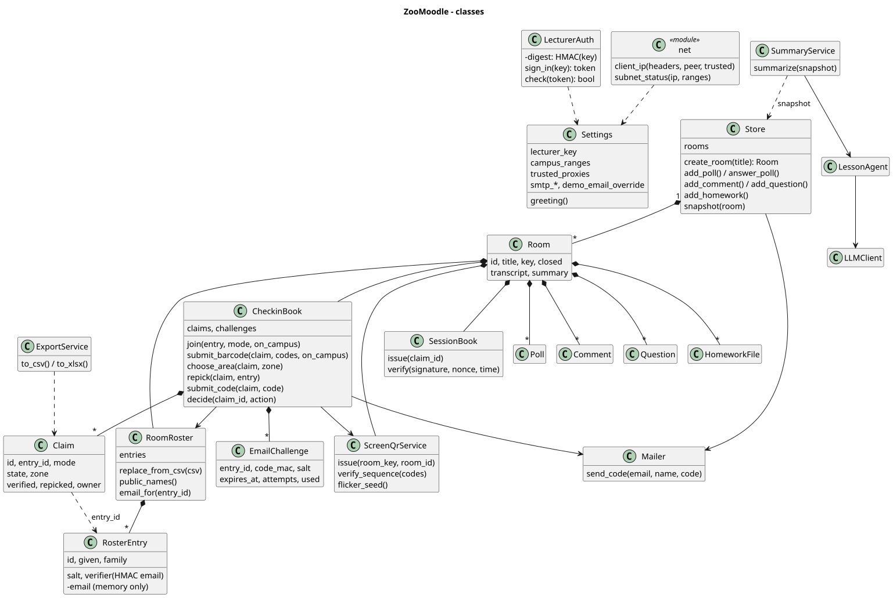
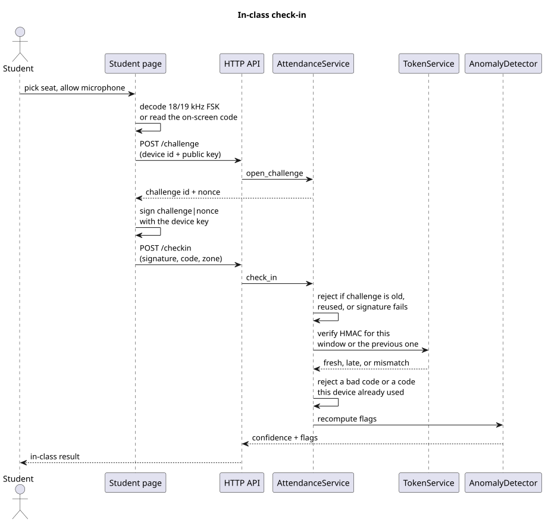
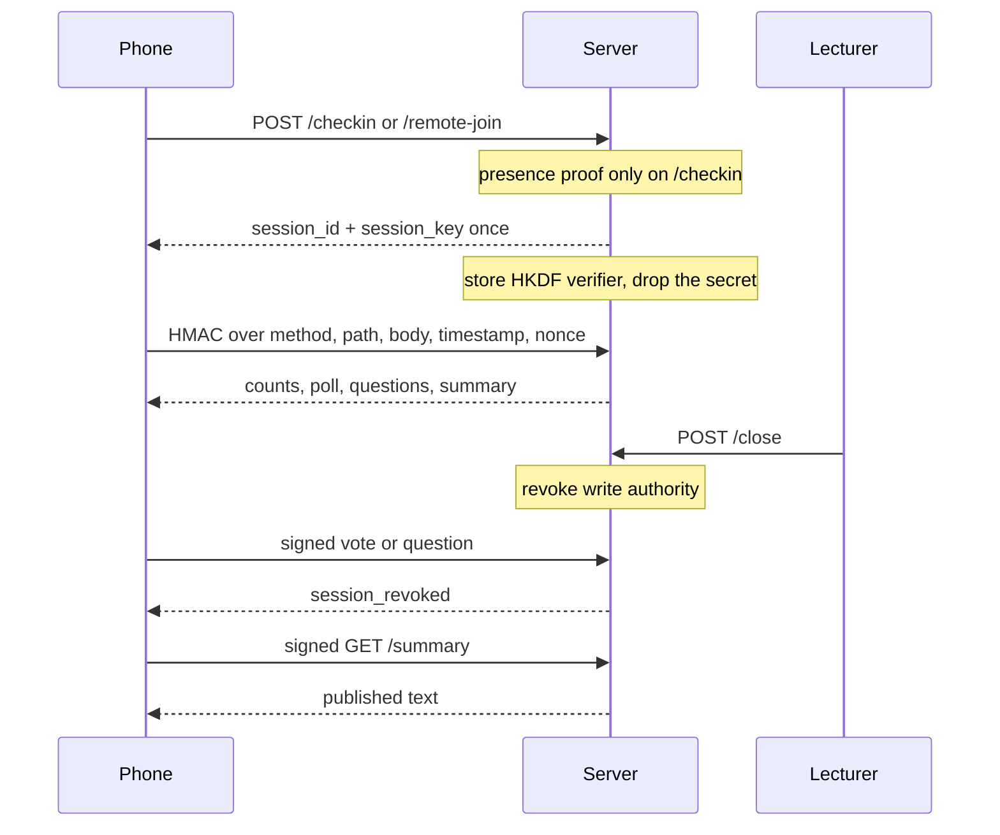
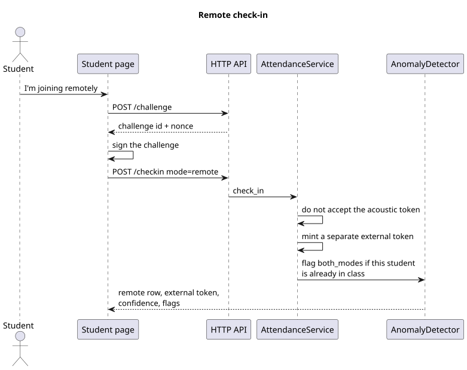
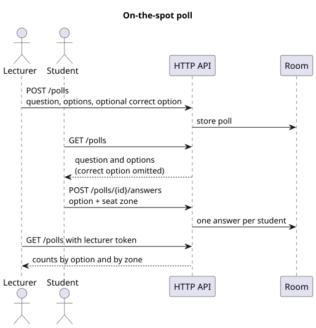
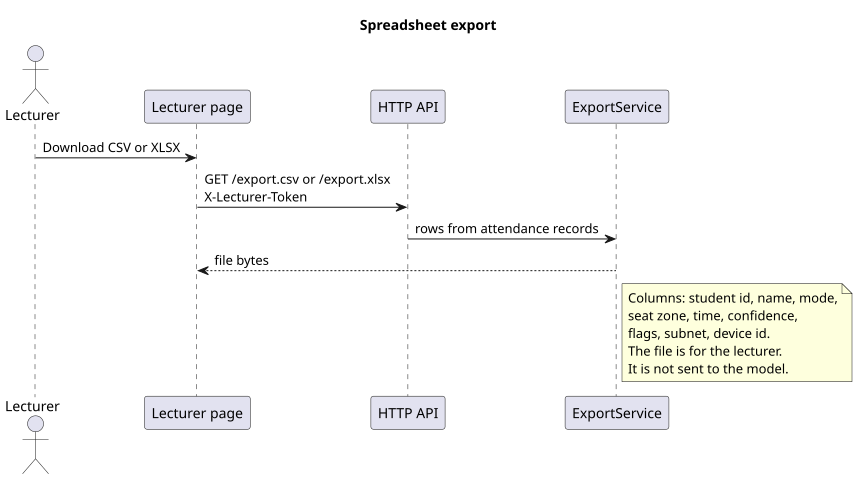
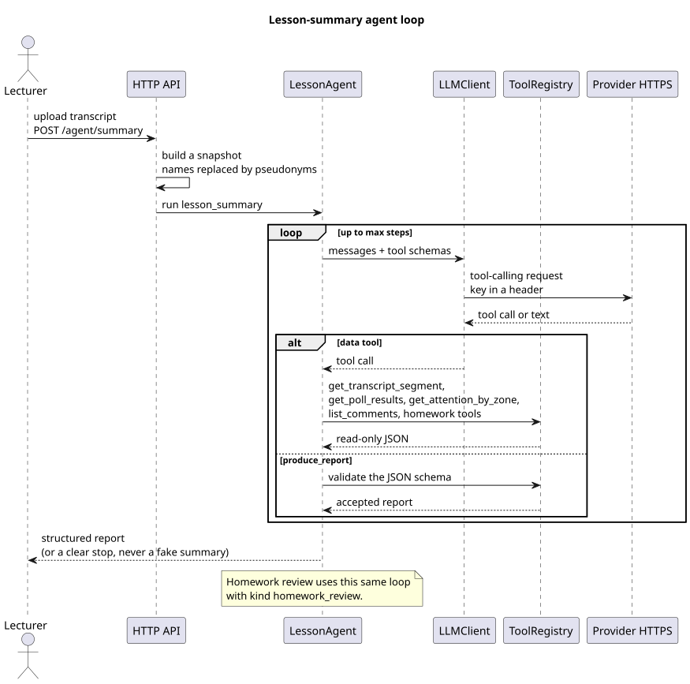
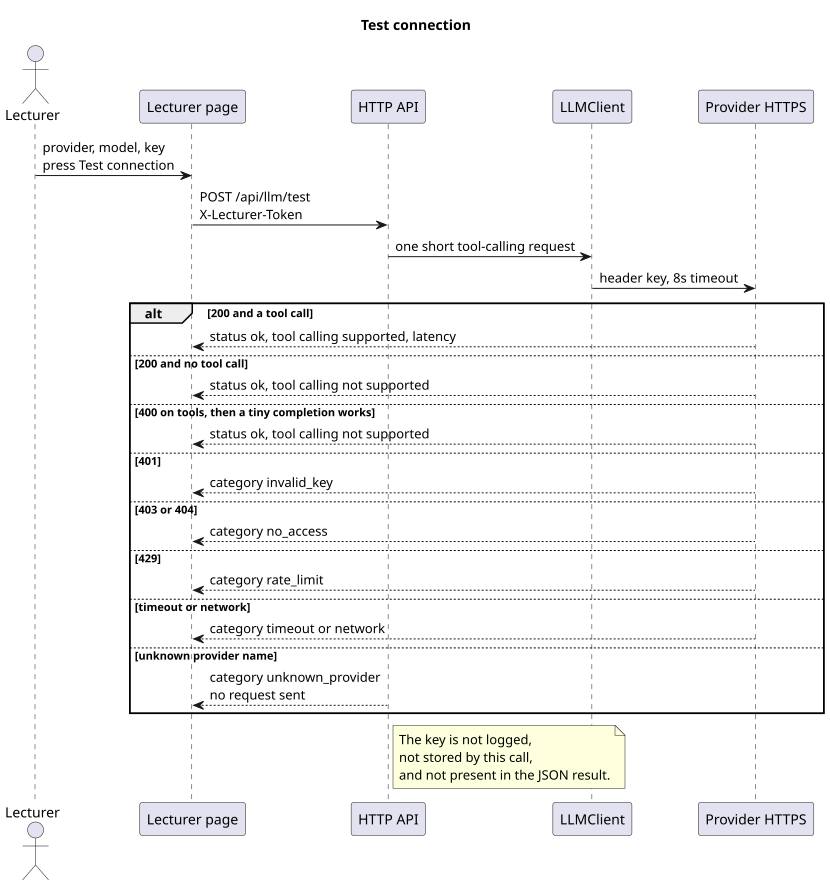

# Design

Class and sequence diagrams for the demo. Sources and SVG exports live in `docs/diagrams/`. The agent itself is specified in `docs/09-ai-agent.md`; the loop sequence is included here so the design set is in one place.

## Design rules that the code follows

- A broadcast token is single-use **per device**. The whole class hears one signal, so every device may redeem the current code once. A second redemption by that device is rejected.
- The previous window is accepted and flagged `late_token`. Older windows fail.
- Remote admission is a different token, stored on a `remote` row. It is not an HMAC of the acoustic payload.
- Names exist on attendance, comments, and homework records. `Store.snapshot` is the only door into the agent, and it redacts them.
- `produce_report` is the only way the agent finishes. There is no offline stub on the HTTP API.
- Attention samples must declare `source=sample-not-camera`.

## Classes



`SeatZone` is a checked value, not a picture of the furniture. `Poll`, `Comment`, and `HomeworkSubmission` are the records on the room. `SummaryService` and `HomeworkReviewService` are thin: they pick the task and call `LessonAgent`. `LLMClient` hides which provider is configured.

Crypto and framing details:

| Item | Value |
| --- | --- |
| HKDF | SHA-256, 32 bytes, salt = room salt, info = `zoomoodle-room-v1` |
| Token message | UTF-8 `roomId\|window\|` concatenated with a 2-byte nonce |
| MAC | First 4 bytes of HMAC-SHA256 |
| On-screen code | Base32 of `nonce \|\| mac`, padding stripped |
| Audio | 48 kHz nominal, 20 ms/bit, 18 kHz = 0, 19 kHz = 1, preamble `11110010`, then 48 payload bits |
| Device signature | ECDSA P-256 / SHA-256 over UTF-8 `challengeId\|nonce`, raw r\|\|s on the wire |
| Device id | First 16 hex chars of SHA-256 of `jwk.x + "." + jwk.y` |
| Session HKDF | SHA-256, 32 bytes, salt = `zoomoodle-session-v1`, info = `zoomoodle-session-mac` |
| Session MAC | HMAC-SHA256 over `METHOD\npath?query\nbody\ntimestamp\nnonce` |
| Session window | 60 seconds, nonce remembered until it falls outside that window |

Confidence starts high for a fresh in-class row. One weakness (late, subnet mismatch, or remote) makes it medium. Two weaknesses, or any of `both_modes`, `shared_device`, `multi_device`, makes it low.

## Sequences

### In-class check-in



The microphone path and the typed code meet at the same POST. The server does not care which one produced the Base32 string. Latency is the age of the challenge, checked before the HMAC result is trusted.

### Per-student session key

Three keys, three jobs:

- The **room key** is HKDF(`zoomoodle-room-v1`) from the master secret and the room salt. It stays on the server and only mints the rotating presence code.
- The **device key** is the phone's P-256 key. It signs the check-in challenge so the server knows the same browser that opened the challenge is the one redeeming the rotating code. It is not used for later lesson actions.
- The **session key** is a 32-byte secret the server creates at a successful in-class check-in or remote join. That response is the only time the secret is returned. The server derives an HKDF verifier (`zoomoodle-session-v1` / `zoomoodle-session-mac`) and stores that verifier, not the secret. The phone keeps the secret in `sessionStorage` and `localStorage` and derives the same verifier to sign later requests.

A lesson action sends `x-zoomoodle-session`, `x-zoomoodle-timestamp`, `x-zoomoodle-nonce`, and `x-zoomoodle-signature`. The signature is HMAC-SHA256 of `METHOD`, the path including the query, the raw body, the unix timestamp, and the nonce. The server rejects a bad MAC (`bad_session`), a timestamp outside 60 seconds (`session_expired`), and a nonce it has already accepted (`session_replay`). Closing the lesson revokes write authority (`session_revoked`): votes, questions, and upvotes fail with that code. Signed reads still work so the phone can load the published summary. The lecturer sheet shows only `verified` or not. The secret is not in the attendance JSON, the overview, or the CSV/XLSX export.

The fixed join QR is the student URL for that room. It is not the rotating presence code. In-class presence is still the sound beacon or the rotating code on the sound tab.



What is tested: the secret differs from the stored verifier; a forged MAC, an old timestamp, and a replayed nonce are rejected; a write after close returns `session_revoked`; a signed read of the summary still succeeds; the secret string is absent from attendance, overview, CSV, and XLSX; the phone signs the lesson calls in the headless browser run. What is only designed: Render's HTTPS proxy is what protects the one response that carries the secret (the app does not terminate TLS); the verifier lives in process memory until the process exits; restarting the process drops every room, including verifiers and used nonces.

### Remote check-in



### Poll



### Export



### Agent loop (lesson summary and homework review)



Homework review is the same loop. The task text names the submission id and the audience (`student` or `lecturer`), and the schema requires `not_a_grade: true`.

### Connection test



Save and test are separate. Test may send a key that is used for that request only.

## Module map

```text
app/main.py            HTTP
app/store.py           rooms and the redacting snapshot
app/crypto_tokens.py   KeyManager, TokenService
app/session_keys.py    per-student HKDF verifier and request HMAC
app/device_keys.py     JWK and ECDSA
app/attendance.py      AttendanceService, DeviceBinding, AnomalyDetector
app/export_svc.py      ExportService
app/attention.py       AttentionAggregator
app/audio_fsk.py       modem used by tests and the VM spike
app/static/fsk.js      the same modem in the browser
app/llm/providers.py   adapters and LLMClient
app/llm/agent.py       LessonAgent, SummaryService, HomeworkReviewService
app/llm/tools.py       ToolRegistry
app/llm/prompts.py     system prompt
```
