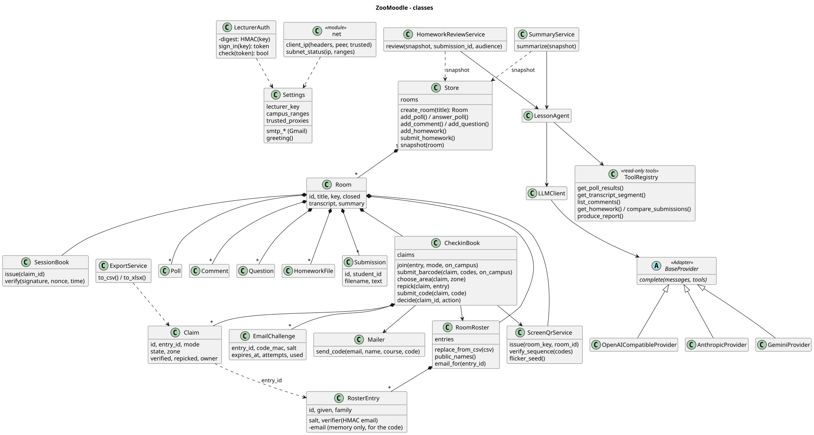
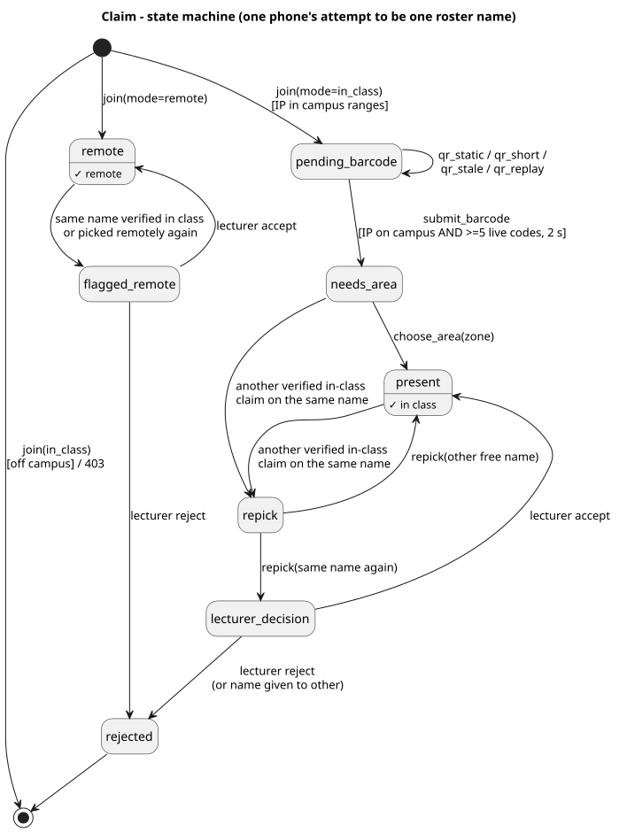
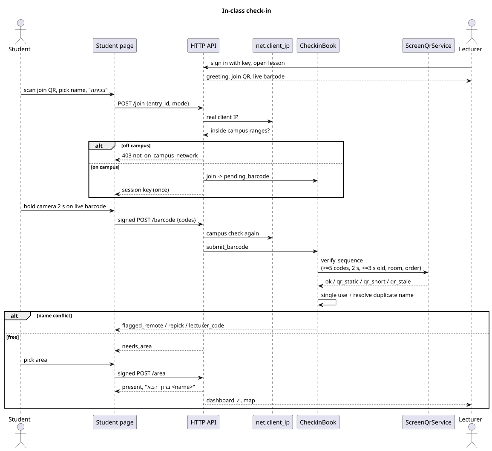
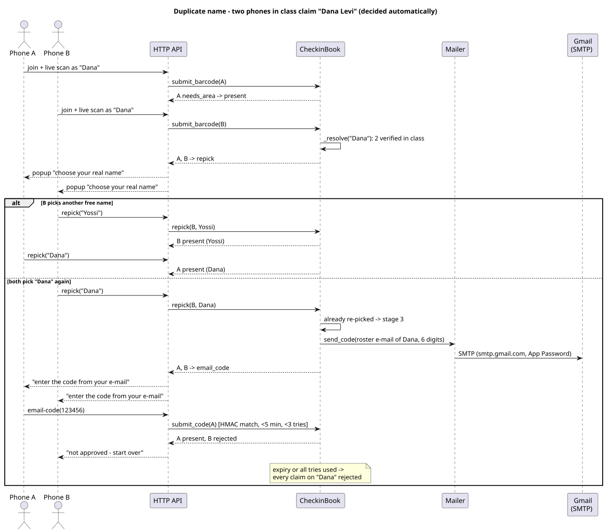
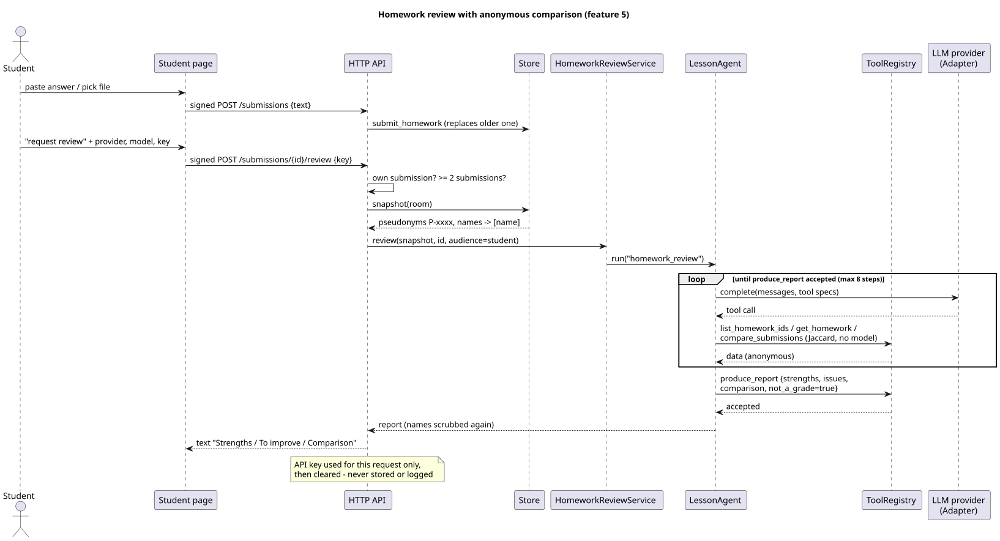

# Design

Diagrams are in `docs/diagrams/` (PlantUML source + SVG). Running and deploying are in the [README](../README.md).

## 1. Classes



A `Room` owns a `RoomRoster`, a `ScreenQrService`, a `CheckinBook`, a `SessionBook` and the lesson records (`Poll`, `Comment`, `Question`, `HomeworkFile`, `Submission`). A `Claim` is one phone's attempt to be one roster name. The LLM side is `SummaryService` / `HomeworkReviewService` → `LessonAgent` → `LLMClient` → a `BaseProvider` subclass, with `ToolRegistry` as the agent's only access to data.

| Item | Value |
| --- | --- |
| Lecturer key | `zmk_` + 32 random bytes; server keeps HMAC-SHA256(master, key) |
| Room key | HMAC-SHA256(master, `zoomoodle-room-v2` ‖ 16 random bytes) |
| Barcode code | `ZM1.` + slot ‖ nonce ‖ HMAC(room key, room id ‖ slot ‖ nonce)[:16]; slot = 250 ms |
| Liveness | ≥5 distinct codes, ≥2 s span, increasing slots, gap ≤3 slots, ≤3 s old at receipt |
| Network | client IP in `192.114.48.0/21`, `192.114.56.0/23` (configurable) |
| Session | 32-byte secret → HKDF verifier; requests signed over method, path, body, time (±60 s), nonce |
| One-time code | 6 digits, HMAC with salt, shown on the lecturer dashboard, renewed every 2 min, 3 tries per phone, a new code after 6 wrong tries, single use |
| Submission | text ≤100,000 chars, one per student; similarity = Jaccard over Unicode word sets |

## 2. Object-oriented design

### Design patterns

| Pattern | Where | Why |
| --- | --- | --- |
| **State** (explicit state machine) | `Claim.state`, transitions only in `CheckinBook` | Check-in has many paths (remote, in class, conflicts). One owner of the transitions keeps every path testable; see the state diagram below. |
| **Adapter** | `BaseProvider` → `OpenAICompatibleProvider`, `AnthropicProvider`, `GeminiProvider` behind `LLMClient` | Each vendor has a different API and tool-call format; the agent sees one `complete(messages, tools)`. A new vendor is one new subclass. |
| **Facade** | `Store` | The HTTP layer calls one object for rooms, polls, notes, homework and the snapshot, not five collections. |
| **Strategy / Template** | `LessonAgent.run(task)` with `SummaryService` and `HomeworkReviewService` | One tool-calling loop; the task decides the goal and the report schema. Features 4 and 5 share the loop. |
| **Command (tool calls)** | `ToolRegistry.dispatch(name, args)` | The model asks for named, read-only commands; it cannot touch state, and every finding can cite the tool output. |
| **Factory** | `build_provider(config)`, `Settings.from_env()` | Build the right object from configuration in one place; tests inject fakes (`app.state.provider_factory`). |
| **Composition over inheritance** | `Room` *owns* its roster, check-in book, barcode service and sessions | A room's parts have one life cycle; no class hierarchy is needed for the domain. |

### SOLID in practice

- **Single responsibility:** barcode crypto (`ScreenQrService`), "who is this phone" (`SessionBook`), "is this IP on campus" (`net`) and "which claim owns a name" (`CheckinBook`) are separate classes, each with its own tests.
- **Open/closed:** a new LLM vendor or a new agent task (feature 4 → feature 5) is added without changing the loop.
- **Dependency inversion:** `CheckinBook` gets its roster and barcode service in the constructor; the agent gets an `LLMClient` from a factory. Tests pass fakes for both.
- **Interface segregation:** the agent sees `ToolRegistry`'s small read-only interface, not `Store`.

### Two design decisions

- Duplicate names: after a re-pick, the **lecturer decides on the spot**. The dashboard shows a one-time code; the lecturer walks to the real student and types it on that phone, which gets the name, and the other phone is removed (it may check in again with another name). The lecturer sees who is sitting there, and nothing depends on students' contact details or an outside service. The accept/reject buttons stay for any other case.
- The homework review (feature 5) **reuses the lesson agent and its tools**: the patterns above make it one service class, three routes and two UI cards.

## 3. Claim state machine



## 4. Sequences

### In-class check-in (two factors)



The network is checked twice — when the student picks בכיתה and when the barcode batch arrives — so a phone cannot start on campus and finish elsewhere. After a valid batch the claim is verified; `CheckinBook` then resolves the name (duplicate stages) before the area makes it `present`.

### Duplicate name



1. A verified in-class claim sets every remote claim of that name to `flagged_remote`.
2. Two verified in-class claims → both `repick`. A different free name resolves it.
3. A claim that already re-picked collides again → `lecturer_code`: one code appears on the lecturer dashboard. The claim on whose phone it is typed becomes the owner; the others → `rejected` (they can start over with another name).
4. Expiry or exhausted tries → every claim on the name → `rejected`; the students start over.
5. The lecturer may still `decide(accept|reject)` any claim.

### Homework review with comparison (feature 5)



`Store.snapshot` builds pseudonymous input (polls, notes, questions, transcript, submissions). `LessonAgent` must call a data tool before `produce_report`; the report must set `not_a_grade: true`. The lesson summary (feature 4) is the same loop with the `lesson_summary` task; the lecturer's summary is stored on the room for all students. The API key lives only in the request.

## 5. Module map

```text
app/main.py           HTTP routes, _run_llm
app/config.py         Settings, key file
app/lecturer_auth.py  LecturerAuth
app/store.py          Store, Room, snapshot
app/domain.py         Poll, Comment, Question, HomeworkFile, Submission
app/checkin.py        CheckinBook, Claim, LecturerChallenge
app/screen_qr.py      ScreenQrService
app/net.py            client_ip, subnet_status
app/session_keys.py   SessionBook
app/roster.py         RoomRoster
app/export_svc.py     ExportService
app/llm/              providers (Adapter), agent, tools, prompts
app/static/           lecturer and student pages, qr.js, jsqr.js
```
